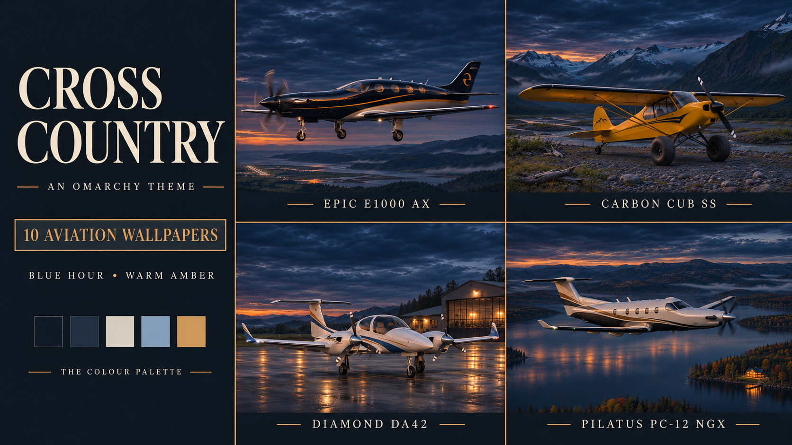

# Cross Country

A dark general aviation theme for Omarchy: blue-black surfaces, soft ivory text, muted slate blue and warm amber accents, with ten cinematic aviation wallpapers.



*The cover is AI-generated promotional artwork showing four examples and the palette direction. It is not a screenshot of the desktop interface.*

## The theme

Cross Country takes its colours from blue-hour flying: dark skies, quiet landscapes, warm hangar windows and the last light on an aircraft. The desktop stays dark while text, selections and active windows remain easy to pick out.

The collection ranges from a Skyhawk at a Tennessee airfield to an Epic on a long final and a Carbon Cub on a remote mountain gravel bar. Seven scenes show aircraft flying, taking off or approaching; three are parked.

This is a complete named Omarchy palette with active and inactive window-border colours. Omarchy generates its supported terminal, editor and shell colours from the palette. The theme supplies colours and backgrounds; it does not install plugins, change fonts or rearrange the desktop.

| Colour | Value |
|---|---|
| Blue-black background | `#151b26` |
| Raised slate surface | `#202a38` |
| Soft ivory text | `#ddd9ce` |
| Secondary text | `#99a3b1` |
| Warm amber accent | `#d2a66c` |
| Muted slate blue | `#8faac7` |
| Selection | `#2b3647` |

Cross Country is a separate theme from [Clearance](https://github.com/shaggyrs6-netizen/omarchy-clearance-theme). They share a cinematic aviation feel; Cross Country centres on general aviation and a darker blue-hour palette.

## Wallpaper collection

| Aircraft | Scene |
|---|---|
| [Cessna 172 Skyhawk](backgrounds/01-skyhawk-3440x1440.webp) | Before sunrise at a misty Tennessee airfield |
| [Mooney M20J 201](backgrounds/02-mooney-3440x1440.webp) | Crossing desert mesas at dusk |
| [Beechcraft V35B Bonanza](backgrounds/03-bonanza-3440x1440.webp) | Evening arrival near a lit runway |
| [Piper PA-28 Archer LX](backgrounds/04-archer-3440x1440.webp) | Lifting off from an English grass strip at dusk |
| [Cirrus SR22T G7](backgrounds/05-cirrus-3440x1440.webp) | Cruising beside cloud towers in the fading light |
| [Daher TBM 960](backgrounds/06-tbm-3440x1440.webp) | Alpine twilight above a mountain valley |
| [Pilatus PC-12 NGX](backgrounds/07-pc12-3440x1440.webp) | Flying over northern lakes and autumn forest |
| [Epic E1000 AX](backgrounds/08-epic-3440x1440.webp) | Black, silver and gold on a long final over coastal countryside |
| [CubCrafters Carbon Cub SS](backgrounds/09-carbon-cub-3440x1440.webp) | Parked on a remote gravel bar beneath rugged mountains at sunset |
| [Diamond DA42 Twin Star](backgrounds/10-da42-3440x1440.webp) | Blue-hour homecoming beside a warmly lit hangar |

All ten backgrounds are **3440 × 1440 WebP exports**, upscaled from AI-generated originals approximately **1915–1939 × 811–821** pixels. Export uses Lanczos resampling with a small centred crop where needed. These are not native 4K or native ultrawide-detail images. Separate 16:9 wallpaper editions are not included; fill/crop display modes on other screen ratios may trim aircraft or scenery.

Aircraft shapes, paint schemes, lighting and approach geometry are artistic interpretations. These are not photographs, technical reference images or operational guidance.

## Installation

Install by repository URL:

```sh
omarchy theme install https://github.com/shaggyrs6-netizen/omarchy-cross-country-theme
```

Select it afterwards if needed:

```sh
omarchy theme set cross-country
```

Use Omarchy's background picker to choose an aircraft, or cycle through the collection:

```sh
omarchy theme bg next
```

This is an Omarchy Quattro palette theme. Installing by repository URL does not require a marketplace listing. No registry listing is claimed.

## Validation and limits

The theme was installed and activated on an Omarchy **4.0.6-1** desktop. Its installed renderer generated **19 configuration files** with no unresolved palette tokens; generated TOML and JSON were parsed. Hyprland reported no configuration errors after activation, and its active-border colour matched the amber accent.

All ten exported wallpapers decode at 3440 × 1440. The **27 selected text/surface contrast checks** pass a 4.5:1 target, with the lowest tested pair at **4.78:1**. Those checks cover selected palette text colours against the background, raised surface and selection colour on opaque surfaces.

These checks do not establish compatibility with every Omarchy version or application, nor whole-desktop accessibility compliance. Transparency, application colour combinations, display calibration and personal comfort can change the result.

## Credits and licence

Theme prepared by Lee Shand / Wired Differently with AI assistance. The ten wallpapers and promotional cover are AI-generated artwork selected for this collection. No aircraft manufacturer or the Omarchy project endorses the theme.

The [MIT licence](LICENSE) covers the supplied theme files, artwork and documentation, to the extent applicable rights exist. It does not promise exclusive copyright in AI-generated imagery or grant rights in third-party trademarks. Aircraft names identify the artistic subjects.

